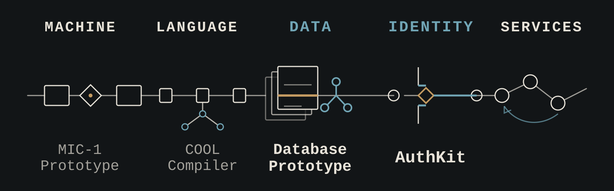

  

# Breno Alvarenga

Software engineer focused on backend architecture, cloud infrastructure
and production-oriented software quality.

I build secure SaaS services and applied AI integrations while studying
the layers beneath modern applications, from databases and compilers to
computer architecture.

**Backend** · Java · Spring Boot · REST APIs · PostgreSQL · Redis · SQL

**Cloud & delivery** · Docker · Kubernetes · Linux · CI/CD · GitHub Actions · Observability

**Security & quality** · OAuth2/OIDC · Authentication · Authorization · Automated Testing · Testcontainers

**Applied AI** · LLM Integrations · AI-assisted Workflows · Retrieval-Augmented Generation

**Selected links** · [LinkedIn](https://www.linkedin.com/in/brenoalvarengaalves/)
