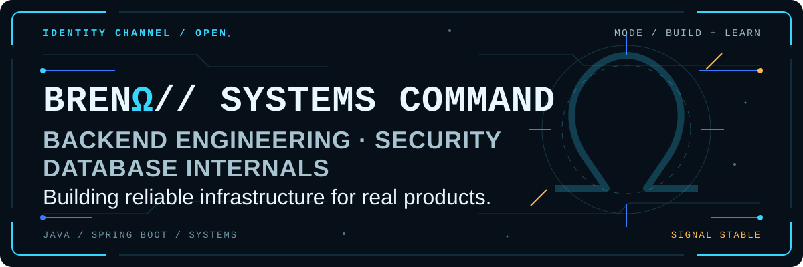
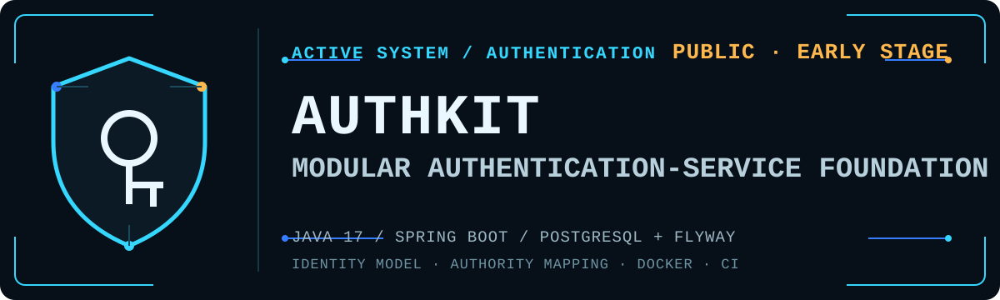
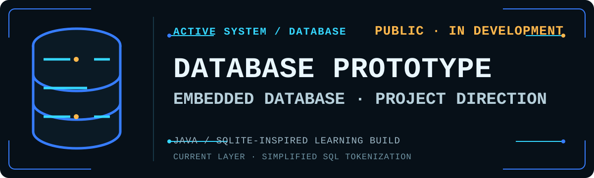

  

<h1 align="center">Breno Alvarenga</h1>

  <strong>Backend developer building secure SaaS infrastructure and exploring database internals.</strong>

## 01 // Mission Brief

I'm **Breno Alvarenga**, a Computer Science student at **Universidade Federal Fluminense (UFF)**. I work primarily on backend systems, with an emphasis on Java, Spring Boot, application security, and software architecture.

Alongside product infrastructure, I study relational databases, compiler construction, parallel computing, and computer architecture—the layers that explain how software behaves below its API surface.

## 02 // Active Systems

**AuthKit** is a modular authentication-service foundation for SaaS applications, built with Java 17 and Spring Boot. Its current public implementation establishes a persistent user and role model, Spring Security authority mapping, Flyway-managed PostgreSQL storage, privacy-aware logging, container packaging, and CI. The repository is at an early stage; it does not yet present a complete authentication flow.

[Inspect the AuthKit repository →](https://github.com/brenomega/authkit)

**Database Prototype** is an early-stage Java project toward an embedded relational database, inspired by SQLite for learning purposes. Its current public implementation is limited to tokenizing simplified SQL statements; storage, planning, and execution are not implemented yet.

[Inspect the Database Prototype repository →](https://github.com/brenomega/database-prototype)

> **PRODUCT // WAVERN**
>
> Financial organization and tax-support software for small Brazilian businesses. Wavern is presented here as a product—not as a public source-code repository.
>
> [Access Wavern →](https://wavern.com.br)

## 03 // Engineering Evidence

| Area | Evidence / current scope |
| --- | --- |
| Authentication and authorization systems | [AuthKit](https://github.com/brenomega/authkit) — identity model, role-to-authority mapping, persistence, and security-oriented infrastructure |
| SaaS and multi-tenant architecture | [AuthKit](https://github.com/brenomega/authkit) — documented SaaS direction; the public code does not yet implement tenant boundaries |
| Relational database internals | [Database Prototype](https://github.com/brenomega/database-prototype) — project direction inspired by SQLite; the public implementation is currently limited to SQL tokenization |
| Compiler construction | [COOL Compiler](https://github.com/brenomega/cool-compiler) — Java front end with JFlex lexical analysis and a Java CUP grammar/parser |
| Parallel computing with MPI/OpenMP | [MPI exercises](https://github.com/brenomega/MPI) — public C examples of message passing, collective operations, and distributed numerical workloads; OpenMP is coursework/study without a linked public implementation |
| Computer architecture | [MIC-1 Prototype](https://github.com/brenomega/MIC1-prototype) — Java model of a datapath, memory, ALU, registers, and microprogrammed control |

## 04 // Technical Capabilities

- **Backend** — Java · Spring Boot · REST APIs
- **Data** — PostgreSQL · SQL · Redis
- **Infrastructure** — Docker · CI/CD practices · observability fundamentals
- **Systems** — parsers · compilers · storage-engine fundamentals · parallel computing
- **Security studies & design** — OAuth/OIDC · sessions · MFA · passkeys · tenant-aware authorization

These are engineering areas I work with or study; the project notes above distinguish implemented public evidence from current design direction.

## 05 // Open Source Transmissions

Currently selecting and contributing to projects related to Java backend, security and database tooling.

## 06 // Contact Channel

- **GitHub** — [github.com/brenomega](https://github.com/brenomega)
- **LinkedIn** — `LINKEDIN_URL`
- **Portfolio** — `PORTFOLIO_URL`

---

  BRENΩ // SYSTEMS COMMAND · BUILDING RELIABLE INFRASTRUCTURE FOR REAL PRODUCTS

